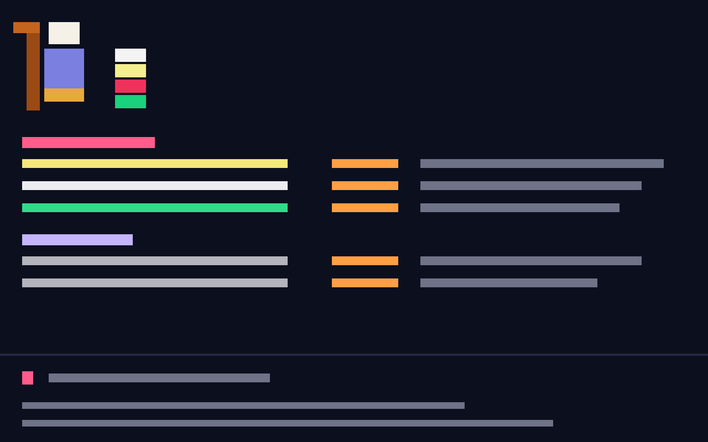

# Shepherd

One dark, borderless window that shows every terminal and agent of every space as a single
dense list, like a flock seen from a hill. A pixel-art shepherd and four colored counts
(agents, working, paused, done) sit at the top, the list fills the middle, and a command line
at the bottom sends text to the selected agent or starts new ones. You never see tabs or
panes. A double click (or Enter on an empty line) opens an agent's live terminal over the
list. The UI text is German.

## What you see

The whole window is one fixed look, background `#0c0f1e`, in `Geist Mono` at 15px. Sizes come
from a 23px mock-up scaled by 15/23, so a row is 20.5px tall and one character column (CH) is
9.1px wide. The theme picker has no effect.

1. **Summary**, 155px tall, padded 13px top and 10px left.
   - The pixel shepherd (`mods/shepherd/shepherd.svg`, 126×196 art drawn at 82×128px): crook
     `#c4651f`/`#9a4a14`, hat `#f5f1e6`, face `#f1c27d`, hair `#e7a93a`, coat `#7b7fe0`/`#5c60c4`.
   - To its right (27px gap, 43px down) are four count rows, each 20.5px tall. Each has a 36px
     colored box with the number right-aligned in `#111318`, then a label in `#b4b4bc`:
     `agents` on `#f4f4f4`, `working` on `#f3ef8e`, `paused` (the blocked count) on `#f0315c`,
     `done` on `#19d27c`. Only agents count, shells don't.
2. **List**, which fills the rest. For each space, top to bottom:
   - A header row: the space name in its color (cycling through `#ff5c8a #c4b5fd #cfc8ff
     #f0f0f4 #34d399 #7dd3fc #fbbf24 #f9a8d4`, semibold), then ` · <count>` in `#a3a3ad`. A
     space on another machine reads `machine/space`.
   - One row per terminal in that space's tabs: starred rows first, then by terminal number.
     The columns, 15px from the left edge, are:
     - the number (right-aligned in 2 CH), then a 3.5 CH gap
     - the status mark (1 CH)
     - the name (30 CH, truncated). An agent's name is drawn in its status color. A shell's
       name is `$ <tab name | process name | term-N>`.
     - `+N` for the agent's live sub-terminals (3 CH)
     - the machine, `lokal` for this one (10 CH)
     - time since the last status change (4 CH, right-aligned, `12s`/`5m`/`2h`, agents only)
     - age of the terminal (5 CH, right-aligned)
     - the program (9 CH) in its color: `claude #ff9f43`, `codex #7dd3fc`, `gemini #8ab4f8`,
       `opencode #c4b5fd`, `pi #f9a8d4`, `grok #e5e7eb`, `terminal #2ecc8f`, any other agent `#a6e3b8`
     - the title (the agent's status message, or the shell's foreground program), truncated
   - The selected row has a `#1b2140` background. A 5px `#232842` scroll thumb shows on the
     right once the rows overflow.
3. **Footer**, with a 1px `#232842` top border, padded 10px top, 15px sides and 14px bottom.
   - Suggestions appear while a `/` command is typed: up to 7 rows of 14px text, 26px tall,
     the highlighted one on `#1b2140`. A 12px `#6f7388` hint follows
     (`↑↓ wählen · Tab übernehmen · Enter setzen|übernehmen · i/n`).
   - Otherwise a one-line message shows, green `#19d27c` for ok and `#f0315c` for errors or
     confirmations.
   - The command line: a semibold `›` (`#ff5c8a` while typing, otherwise `#6f7388`) and the
     input. The placeholder reads `Klicken zum Tippen`, or while typing `Auftrag an <name> …`
     or `Neuer <who> in <space> …`.
   - Two 13px key/value lines, keys in `#6f7388`:
     - `machine` · `where` (`#c4b5fd`, plus `·sel` when following the selection) · `who`
       (program color) · `model` · `effort`
     - `ctx` (used/size of the selected Claude session's context window, with a percentage)
       · `cache` (`noch Nm`, `noch <1m` or `abgelaufen`) · `5h` and `7d` quota percentages
       with reset times (`↻ 03:30`, or `↻ Sa 17:00` on another day). Percentages are green
       below 60, `#f4e97a` from 60 and red from 80.

## How it behaves

- **Statuses.** Each one's mark and name use the same color:
  - working: a braille spinner `⠋⠙⠹⠸⠼⠴⠦⠧⠇⠏` at 90ms per frame, `#f3ef8e`
  - blocked: `‖`, `#f0315c` (counted as "paused")
  - done: `✔`, `#19d27c`
  - idle: `●`, `#b4b4bc`
  - shell: `▸`, `#ff4d6d`
  - A starred agent shows `★` in its status color.
- **Selecting.** ↑/↓ moves the selection over terminal rows only, skipping headers, and keeps
  a space's header visible at its first row. PageUp/PageDown move 15 rows. Clicking a row
  selects it. Clicking a header selects its first terminal. The mouse wheel scrolls whole
  rows. The selection survives restarts.
- **Peek.** A double click or Enter on an empty line opens a centered dialog (80%×80%): the
  shipped `peek` bar (30px) over the live terminal, which gets focus, plus a 0px block with a
  guard copy of the mod. While it is open the keyboard stays in it: if the command line takes
  focus, it hands it straight back with `pane.focus`. Escape closes it, selects that agent's
  row and gives the keyboard back to the list, so ↑/↓ go on from there. ⌘↩ closes it too and
  puts the keyboard on the command line (`Tippen für <name>`), as it does without a peek.
- **Typing.** Plain text plus Enter is sent to the selected terminal (`hc send <addr> -- <text>`,
  so text starting with `-` stays text) and the line shows `→ <name>`. For a shell row it asks
  first in `#f4e97a` ("Shell … führt das als Befehl aus: „…“ – senden?"), since a shell runs
  what it gets: Enter on the empty line sends, Escape or typing cancels.
- **Commands.** Each one autocompletes as you type. ↑/↓ pick a suggestion, Tab fills it in,
  and Enter applies it.
  - `/who` sets the agent for new agents: installed agents, otherwise `claude`/`codex`.
  - `/where` sets the target space by name; `.` or `-` means "the selected row's space".
  - `/model` lists the `/who` agent's models: Claude's from `~/.shepherdr/cli-models.json`
    (shown with id and default effort), Codex/pi/grok's from their config and the models
    their latest sessions used (`MODELS_SEEN`, read once at start). Free text works too.
  - `/effort` lists the levels the agent takes: Claude's per model from cli-models.json,
    else `codex: minimal low medium high xhigh`, `pi: off minimal low medium high xhigh`,
    `grok: low medium high`. Picking a model or agent that doesn't take the current level
    resets it to the model's default, else `medium`.
  - Any command with values opens their list when Enter comes without one.
  - `/new <task>` opens a tab in `/where` running the `/who` agent with that first message.
    Typing on a header row needs `/new`.
  - `/space <folder> [name]` creates a space whose first tab runs the agent, and makes it the
    new `/where`. The folder is autocompleted from the folders under the typed path.
  - `/space gh:owner/repo` lists your GitHub repos (most recently pushed first) and reuses an
    existing clone under `~/dev`. Otherwise it clones into `~/dev/<repo>`, or
    `~/dev/<owner>-<repo>` if that name is taken. Only `owner/repo` in `A-Z a-z 0-9 . _ -`,
    no part starting with `-` and no `.`/`..` part, is taken.
  - `/machine` picks the computer for `/space` (`lokal`, or a saved herdr machine).
  - `/star`, or a right click on a row, toggles the star.
  - `/close` asks before closing anything. It closes the selection (also on ⌘⌫ with an empty
    line), `done` closes all finished agents, `shells` all shells, `space [name]` a whole
    space. The question names how many agents are still working, and whether the last tab of
    a space goes too. Enter confirms, Escape cancels, and typing anything also cancels.
- **Escape**, in order: cancels a pending confirmation, else closes the peek (selecting its
  row), else clears the line.
- **Names.** Each Claude session's first real request (4+ words, not a command) is named by
  `claude -p --model haiku` into a 1–3 word kebab-case name, e.g. `stand-abfragen`, kept per
  session id. In front goes a three-letter code of the session's repo (`origin`'s name, else
  the git folder, else the working folder): initials of three or more words, the first letter
  and next consonant of the first word plus the second's initial for two, the first letter and
  next two consonants for one; up to three letters stay as they are (`webshop` → `wbs`,
  `landing-page` → `lnp`). The result, e.g. `wbs-stand-abfragen`, replaces the session or tab
  name in the list.
- **Codex.** A row is Codex when its status app starts with `codex` or its foreground argv has
  `codex`/`codex.js`. Its rollout is the `rollout-*.jsonl` the process or a child holds open
  (`lsof`), else the one under `${CODEX_HOME:-~/.codex}/sessions` with the same `cwd` in its
  `session_meta` that started closest to the process (`ps -o etime=`). It is looked up again
  when the pid changes. From it come the first request (`event_msg`/`user_message`) for the
  name, `ctx` (the last `token_count`'s `last_token_usage.total_tokens` of
  `model_context_window`), model and effort (`turn_context`) and quota (`rate_limits`
  `primary`/`secondary`, labelled by `window_minutes`, resets from `resets_at` or
  `resets_in_seconds`). Codex keeps no cache time, so `cache` shows `—`. The quota line also
  reads the newest rollout on every refresh.
- **pi and grok** work the same way (one script, `AGENT_FIND`/`AGENT_READ`, takes the kind),
  detected by status app or argv `pi`/`grok`:
  - pi: `${PI_CODING_AGENT_DIR:-~/.pi/agent}/sessions/--<cwd with / as ->--/<time>_<id>.jsonl`,
    header `{"type":"session","id","cwd","timestamp"}`. Name from the first `message` with
    role `user`; `ctx` from the last assistant `usage.totalTokens`, model from its `model`,
    effort from the last `thinking_level_change`; `cache` 5 minutes after the last answer when
    its `provider` is `anthropic` and it used `cacheRead`/`cacheWrite`.
  - grok: a session is the folder `${GROK_HOME:-~/.grok}/sessions/<url-encoded cwd>/<id>/`,
    matched by `summary.json` (`id`, `cwd`, `created_at`, `current_model_id`). Name from the
    first `chat_history.jsonl` `user` record without `synthetic_reason`; `ctx` from the last
    `turn_completed` in `updates.jsonl` (`inputTokens` + `outputTokens`, found anywhere in the
    record); effort from the last assistant's `reasoning_effort`.
  - Neither stores its window size, so `ctx` shows only the tokens used, and neither has
    quota.
- **Refresh.** Terminal facts, sessions and quota refresh every 8s. The selected row's
  context and cache refresh every 3s and on every selection change.

## Built from

- `layouts/shepherd.json`: a root `column` (`#0c0f1e`, `"preview": "layouts/shepherd.svg"`)
  with one block, `{ "id": "shepherd", "content": { "mod": "shepherd" } }`.
- `mods/shepherd/` contains `main.js`, `mod.json` (`{ "place": "none" }`) and
  `shepherd.svg` (the pixel shepherd).
- **Host and window.** Without `props().overlay` the mod only paints the background and, on
  every `on_size_change`, opens itself in a frameless window over the block:
  `openOverlay({ mod: "shepherd", kind: "window", key: "shepherd-<w>x<h>+<top>", frame:
  "none", width, height, at: { x: 0, y: top } })`. `top` is 28 on macOS with the system title
  bar, otherwise 0. The open window is remembered in `setShared("shepherd.window")` and
  closed before reopening, and again in `close()`.
- **Keys.** `keys.json` needs `"layout:shepherd": { "escape": "shepherd.escape", "cmd-enter":
  "shepherd.type" }`, read
  through `nextCommand()`. The rest is `on_key_down` on the root plus gpui-base
  `InputState`/`Input` events (`change`, `submit`, `focus`, `blur`).
- **herdr API.** `spaces`, `machines`, `panes`, `agents`, `terminals`, `knownAgents`, `home`,
  `readTextFile` (with `{ on }` for other machines), `exec` (with `{ on }` and `cwd`), `hc`,
  `run`, `openOverlay`, `closeOverlay`, `window`, `shared`, `setShared`, `props`,
  `nextCommand`, `localStorage` (keys `sel`, `stars`, `short`, `cfg`). Commands: `tab.new`,
  `tab.close`, `space.new`, `space.close`, `terminal.kill`, `pane.focus`. `hc get <addr>
  --json` supplies `created_ms`, `status_ms`, `foreground` and `status.msg`.
- **Shipped mod used:** `peek`, in the peek dialog's 30px top block.
- **Programs it runs:**
  - `gh api user/repos …` and `gh repo clone`
  - `sh -c` to list folders and `~/dev` clones (on the `/machine`)
  - `test -e`
  - `python3 -I -c` to read a transcript's first request, and to find and read Codex, pi and grok sessions
    (with `pgrep`, `lsof`, `ps`)
  - `git remote get-url origin` / `git rev-parse --show-toplevel` for the repo code
  - `claude -p --model haiku …` for names
  - `tail -c 600000` on the session transcript
  - for codex quota: `ls` over `~/.codex/sessions`
- **Files it reads:**
  - `~/.claude/sessions/<pid>.json`
  - `~/.claude/projects/<cwd-slug>/<id>.jsonl`
  - `~/.claude/statusline-cache/<id>.json`
  - `~/.claude/quota-cache.json`
  - `~/.shepherdr/cli-models.json` (`claude.models`/`claude.others`/`claude.default`)
- **Art:** `shepherd.svg` is drawn on a 14px grid. `layouts/shepherd.svg` is a 320×200
  abstract preview for the settings screen.

## Watch out

- A plain layout block never gets the keyboard (Herdr keeps it with its panes), so the list
  must live in the frameless overlay window. Every size gets its own window key, because a
  key keeps the spot it first opened at.
- The `y` origin of window coordinates sits above the macOS title bar, so the window needs
  `top = 28` there.
- Draw only the rows that fit (`floor(listH / ROW)`, plus 1). A full list with spinners
  re-renders too much.
- Read transcripts with `python3`, not `readTextFile`. One message with an image is a
  multi-MB line.
- A pending confirmation (`/close`, or text for a shell) must clear as soon as anything is
  typed and on every selection change (↑/↓, PageUp/PageDown, click, right click). Otherwise
  Enter, meant to open the newly selected row, would still send or close.
- Closing the peek hands the keyboard back to its terminal, so the line is focused again after
  80ms. A peek can also close without the mod (its ✕, a click beside it, its terminal ending),
  so a guard copy of the mod rides in it as a 0px block, `{ mod: "shepherd", props: { guard:
  <addr> } }`, sets `shared("shepherd.peek")` while it lives and clears it in `close()`.
  Right after opening, the guard may not have reported yet, so the first 1.5s count as open.
- Enter takes the highlighted suggestion, except for a `/space` path, which is created as
  typed.
- The setup is assumed to have:
  - `gh` logged in, for `gh:` repos
  - `python3` and `claude` on PATH, for names
  - Claude Code writing the session, statusline-cache and quota-cache files above. A
    statusline hook must write `~/.claude/statusline-cache/<session>.json` and
    `~/.claude/quota-cache.json`, otherwise `ctx`, `cache` and quota show `—` or
    `keine Daten`.
  - `~/dev` as the clone folder (`CLONE_DIR`)
  - the font `Geist Mono` installed
- The quota line shows the `/who` agent. Gemini and others show no quota.
- Session names and the context line work for Claude Code, Codex, pi and grok; `cache` for
  Claude and for pi on Anthropic.
- The Codex, pi and grok parts were written against their formats (pi from its docs, grok from
  third-party descriptions) without a live install to try them on.
- The `+N` column counts live terminals whose `parent` is the row's terminal.

## Done when

- `herdr-app check mods/shepherd` passes, and `layout.switch {"name":"shepherd"}` shows the
  shepherd, four counts, the list and the footer with no title-bar gap.
- Every space appears as a colored header with its terminal count, and each terminal shows
  number, mark, name, machine, ages, program and title in the column layout above.
- A working agent spins in `#f3ef8e`, and the `working` count matches the spinning rows.
- ↑/↓ skip headers. Enter on an empty line opens the peek dialog, and Escape closes it.
- Typing `hallo` and Enter on an agent row puts `hallo` into that agent and shows `→ <name>`.
- `/effort` lists the five levels, `/effort high` shows `effort → high`, and the footer
  updates.
- `/new <task>` opens a new tab in the `where` space running the chosen agent with that task.
- A right click stars a row, which moves to the top of its space with `★`.
- `/close done` asks first and closes only finished agents.
- After a Claude session's first real request, its row is renamed to a short kebab-case name
  within about 10s.
